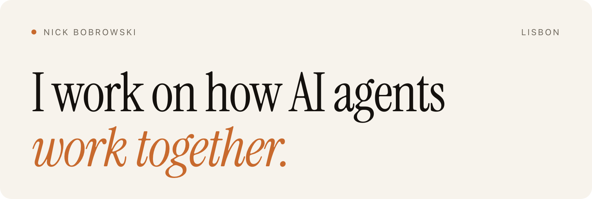

<a href="https://nicko.ai">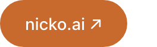</a>&nbsp;
<a href="https://www.linkedin.com/in/nicko-ai">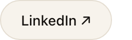</a>&nbsp;
<a href="https://x.com/nicko_ai">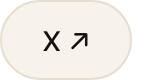</a>

 

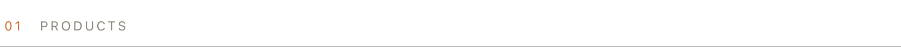 
<a href="https://padelinstinct.com">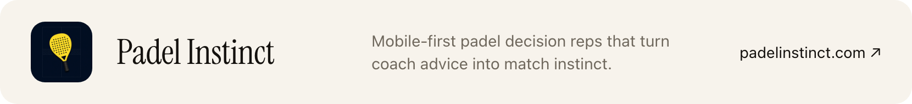</a> 
<a href="https://afluento.com">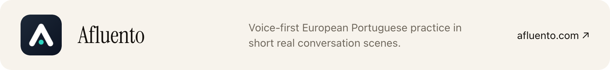</a> 
<a href="https://korine.app">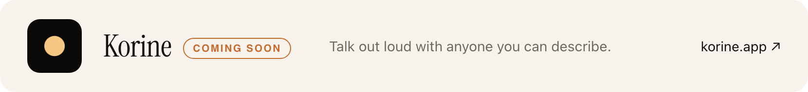</a>

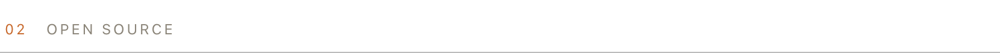 
<a href="https://github.com/VRSEN/agency-swarm">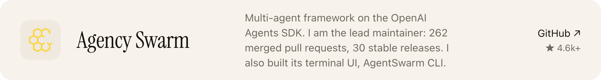</a> 
<a href="https://github.com/VRSEN/OpenSwarm">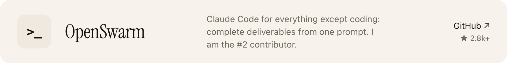</a>

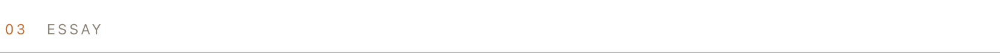 
<a href="https://nicko.ai/blog/one-control-plane/">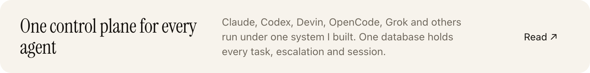</a>
